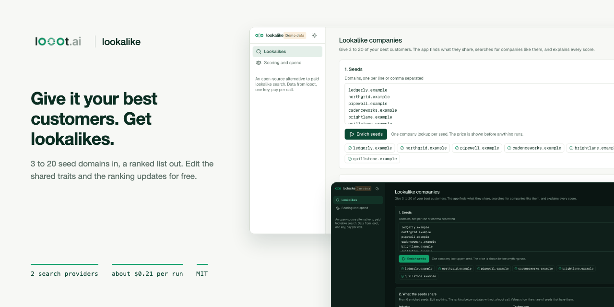
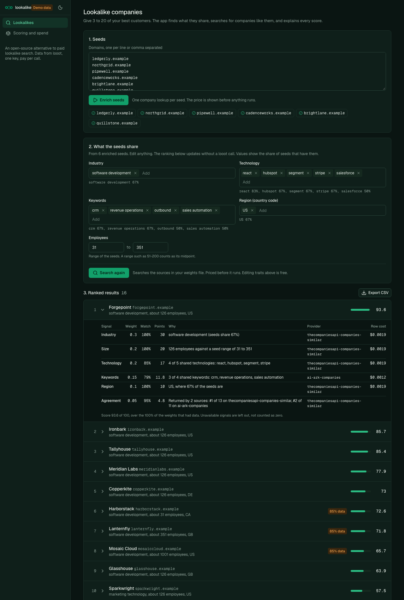
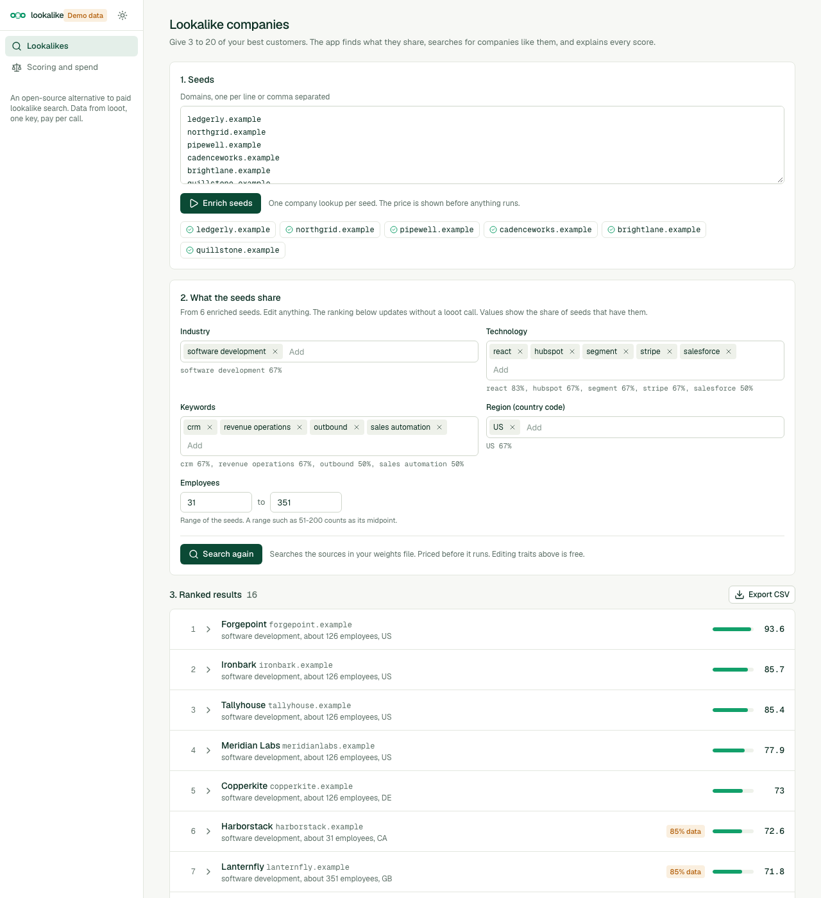

<p align="center"></p>

# looot-lookalike

[](LICENSE) [](https://github.com/loootai/looot-lookalike/releases) [](https://docs.looot.ai)

An open-source alternative to Ocean.io style lookalike company search. Give it 3 to 20 domains of your best customers. It enriches them through looot, derives what they share (industry, size, technology, keywords, region), searches for similar companies with looot's company search providers, scores each result with a breakdown you can read, and returns a ranked list. You can edit the shared traits and the ranking updates without another paid call.

Ocean.io's own pricing page refused automated reading on 2026-10-10 (HTTP 403). Third-party estimates from review sites run from about $32 to $79 a month. None of them is an Ocean figure, so check Ocean's page before you compare. looot-lookalike has no subscription. A run costs the list price of its calls, shown before it starts.




## What you need

- Node 22.12 or newer. The repo has no `engines` field or `.nvmrc`. Next.js 16 needs 20.9 or newer and the test runner (Vitest 5) needs 22.12 or newer. I ran it on Node 24.
- npm.
- A looot account and token, only for real runs. Sign up at https://looot.ai/auth/sign-up. To get a token, run `looot login` (`npm i -g looot`), which opens a browser approval. Or in the looot web app go to Settings, "Agent tokens", and create one (https://docs.looot.ai/get-started/sign-in). With no browser or in CI, create the token in Settings, Agent tokens, then `export LOOOT_TOKEN=...`. The token needs the scopes runs.execute, catalog.read, runs.read and usage.read.
- A funded balance. Minimum top-up is $5. Signing up adds no credit (https://docs.looot.ai/money).

No other account is needed. The app does not use Supabase, an LLM key or any other service.

## Try it in one minute

No account and no token.

```bash
git clone https://github.com/loootai/looot-lookalike && cd looot-lookalike
npm install --ignore-scripts
npm run demo                                  # web UI on http://localhost:3230
npm run lookalike -- --demo --out results-out
```

The demo uses made-up companies on the reserved `.example` domain. The CLI demo prints "16 ranked companies from 16 candidates. Spent $0.10 of $1.00." and writes `.json`, `.csv` and `.md` files to `results-out/`.

## Run it with your own data

```bash
cp .env.example .env.local          # web app only, then set LOOOT_TOKEN
export LOOOT_TOKEN=...              # CLI: it does not read .env.local
cp weights.example.yaml weights.yaml
```

The web app reads `.env.local`. The CLI reads only the shell environment.

| Variable | Required | What it does | Where to get it |
|---|---|---|---|
| `LOOOT_TOKEN` | Required for real runs, not for `--dry-run`, `--demo` or the demo UI | Bearer token for the looot API | Settings, Agent tokens in the looot app, or `looot login` |
| `LOOOT_API_URL` | Optional | looot API base URL used to read live prices. Default `https://api.looot.ai` | Leave unset |
| `LOOKALIKE_CAP_USD` | Optional | Most one web UI action (enrich seeds, search) may spend. Default 1. The CLI uses `--cap` instead | A dollar amount you choose |
| `LOOKALIKE_WEIGHTS` | Optional | Weights file the web app reads. Default `weights.yaml`, else `weights.example.yaml` | A path you choose |
| `LOOKALIKE_SESSION` | Optional | File where the web app keeps the current session. Default `data/session.json` | A path you choose |
| `NEXT_PUBLIC_DEMO` | Optional | `1` turns on demo mode. `npm run demo` sets it | Do not set it for real use |

Seeds are 3 to 20 domains, one per line or comma separated. URLs are reduced to the host. `examples/seeds.txt` holds three fake `.example` domains, so use your own best customers for a real run. Dry run first. It needs no token and calls nothing:

```bash
npm run lookalike -- --seeds examples/seeds.txt --dry-run
```

Real output from that command:

```
Calls this run (list prices dated 2026-10-10):
  seed     companyenrich-companies-enrich-get       $0.0098  acme.example
  seed     companyenrich-companies-enrich-get       $0.0098  globex.example
  seed     companyenrich-companies-enrich-get       $0.0098  initech.example
  similar  thecompaniesapi-companies-similar        $0.0950  TheCompaniesAPI, similar to domains
  similar  ai-ark-companies                         $0.0600  AI Ark, lookalike search (up to 5 domains)
Total at most $0.1844 for 5 calls. Cap $1.00.
Dry run: no looot call was made and nothing was written.
```

Then the real run, and the web UI:

```bash
npm run lookalike -- --seeds seeds.txt --cap 1 --out results-out
npm run lookalike -- --domains acme.com,globex.com,initech.com --cap 1
npm run dev                         # web UI on http://localhost:3000
```

CLI options are `--seeds <file>` or `--domains a,b,c`, `--weights`, `--out`, `--top`, `--cap` (dollars, default 1), `--dry-run` and `--demo`. Each run writes `lookalikes-<timestamp>.json`, `.csv` and `.md` to the `--out` folder (default `results-out/`). The markdown has the shared traits and, for each result, the breakdown with provider and cost. The CLI keeps no state between runs. With no token a real run prints the quote and then `LOOOT_TOKEN is not set...` (see Troubleshooting).

## Spending

- The quote is shown before any paid action. In the CLI it is `--dry-run`. In the UI it is a price dialog that sends back the amount you confirmed. If the live price is higher, nothing is called.
- One cap covers a CLI run (`--cap`, default $1). The web UI applies `LOOKALIKE_CAP_USD` (default $1) to each step. A call that would cross it is skipped and listed as `skipped_budget`.
- Typical run at list price. 6 seeds and 50 rows from each source cost at most $0.2138. Ten seeds cost at most $0.253. `enrichTop: 10` adds up to $0.098. The sample run reads $0.10 because the sources returned fewer than 50 rows. No real run was priced.
- Failed calls are not charged by looot.
- Every call has a stable `idempotencyKey` made from the step, the endpoint, a hash of the input and the month. Repeating a lookup in the same month replays the stored run and does not charge twice.
- A call still running when waiting stops is `pending`, never failed. Its run id is stored and read again, free.
- Calls are pinned to one endpoint with no provider fallback, so the price is the one quoted.
- Editing traits and re-scoring makes no looot call.

## Weights file

`weights.example.yaml` is the scoring configuration. Copy it to `weights.yaml` (git ignores that name) and edit the numbers, not the keys. Pass another file with `--weights`.

| Key | Meaning |
|---|---|
| `weights.industry`, `size`, `technology`, `keywords`, `region`, `agreement` | Weight of each signal, 0 to 10. At least one must be above 0. They need not add up to 1. The score divides by the weights that had data. Example values are 0.30, 0.20, 0.20, 0.15, 0.10, 0.05. |
| `minSeedShare` | Default 0.4. A trait counts as shared when this share of the seeds that report it have it. |
| `minCoverage` | Default 0.35. Candidates with less than this share of the weights available are dropped. |
| `candidatesPerSource` | Default 50, range 1 to 100. Rows to ask each search provider for. |
| `searchSources` | List of `thecompaniesapi_similar` and `ai_ark_lookalike`. At least one. Default both. |
| `seedEnrich` | `companyenrich` (default) or `hunter`. Which provider enriches the seeds. |
| `enrichTop` | Default 0, range 0 to 50. Enrich this many top candidates to fill gaps. Each costs one enrich call. |

## How it works

1. Enrich each seed by domain, one lookup per seed.
2. Derive traits. A value counts as shared when at least 40% of the seeds that report it have it (`minSeedShare`). Size is the min and max employee count of the seeds.
3. Search. Each configured source returns up to 50 candidates for the seeds. Companies found by both sources are merged and the seeds themselves are removed.
4. Optionally enrich the top candidates (`enrichTop`) to fill missing fields.
5. Score and rank.

## The score

Six signals, weights in `weights.yaml`:

| Signal | Match rule |
| --- | --- |
| industry | A candidate industry the seeds share. Full marks for the most common seed industry. |
| size | Inside the seed employee range is 1, falling to 0 at ten times outside it. |
| technology | Share of the seeds' shared technologies the candidate also uses, weighted by how many seeds use each. |
| keywords | The same overlap rule on keywords. |
| region | The candidate's country is one the seeds share. |
| agreement | How many search providers returned the company and how high they ranked it. |

Each result lists every signal with its weight, match, points, the reason in words, the provider that supplied the value and the list price of that row. A signal with no data on the candidate is left out and the others are scaled to fill 100, so a thin record is shown with its coverage ("85% data") instead of being scored as a miss. Candidates under `minCoverage` (35% of the weights) are dropped. Ranges such as "51-200" count as their midpoint, and the UI says so.

## Signals, providers and cost

Prices are looot list prices from the public catalog, read on 2026-10-10.

| Step | looot job | Endpoint | List price |
| --- | --- | --- | --- |
| Enrich a seed (default) | company.enrich | companyenrich-companies-enrich-get | $0.0098 per call |
| Enrich a seed (option) | company.enrich | hunter-companies-find | $0.0049 per call |
| Search, similar to domains | company.similar | thecompaniesapi-companies-similar | $0.0019 per result |
| Search, lookalike of up to 5 domains | company.lookalike | ai-ark-companies | $0.0012 per result |

A typical run, 6 seeds and 50 rows from each source, is at most $0.2138 at list price. Ten seeds is at most $0.253. `enrichTop: 10` adds up to $0.098. The sample run reads $0.10 because the sources returned fewer than 50 rows. No real run was priced.

## Deploy

There is no `vercel.json` and no GitHub workflow in this repo. The web app keeps its session in a JSON file on disk (`data/session.json`, or `LOOKALIKE_SESSION`), so it needs a host with a writable, persistent disk. I have not deployed it. On such a host run `npm ci --ignore-scripts && npm run build && npm start` and set `LOOOT_TOKEN` (and the optional variables) in the host environment. There is no sign-in, so put it behind your own access control. The CLI needs no host. Run it where you have Node.

## Troubleshooting

| What you see | What it means and what to do |
|---|---|
| `LOOOT_TOKEN is not set. Create an agent token at https://looot.ai/settings, or use --dry-run or --demo.` | The CLI found no token. Exit code 2. Export `LOOOT_TOKEN`, or use `--dry-run` or `--demo`. |
| `LOOOT_TOKEN is not set on the server.` | The web app run button with no token. Set it in `.env.local` and restart. |
| `401: ...` or `looot returned HTTP 401` on a call in the run output | The token is wrong, expired or lacks a scope. Create a new one with runs.execute, catalog.read, runs.read and usage.read. |
| `402: ...` or `looot returned HTTP 402` | The balance is too low. The code shows the API's code and message and does not check this itself. Top up (minimum $5) and run again. |
| A call line ending in `blocked` or `stopped` | looot did not run the call. The line shows the status and the API's error if there is one. Open the run in your looot app for the reason. |
| `pending` on a call | The call is still running at the provider. Run again later. It is read again for free. |
| `skipped_budget` | The cap was reached. Raise `--cap` if you accept the cost. |
| `Give at least 3 seed domains. You gave N.` or `Give at most 20 seed domains. You gave N.` | Seeds must be 3 to 20 domains. Exit code 2. |
| `"<text>" is not a domain.` | A seed value could not be read as a domain. Exit code 2. |
| `Only N of M seeds could be enriched. At least 2 are needed.` or `Fewer than two seeds were enriched, so there is nothing to search with.` | Too few seeds came back from enrichment, so there are no shared traits. Check the failed seed lines, then use better-known domains. Exit code 1. |
| `The price is now ... micro-dollars, above the ... you confirmed. Nothing was called.` | The web app price rose after you saw the quote. Open the quote again. |
| `The weights file is not valid YAML: ...` or `<key>: <message>` | The weights file failed the check. Exit code 2. Fix the key named in the message. |
| A call completes but the candidate has empty fields or few results | The normalizer did not recognise the response shape. It leaves a field empty when it finds none. Open an issue with the raw response. |

How to file an issue. Open one at https://github.com/loootai/looot-lookalike/issues with the run id (the web app's `data/session.json` stores it for each call; the CLI does not print or save it, so give the time of the call and the endpoint id instead), the command you used, and the raw response body with secrets removed.

## Status

- No paid looot run was made. Response parsing is built from each provider's public docs and the fixtures in `src/demo/fixtures.ts`. The normalizer reads several field names per value and leaves a field empty when it finds none, but no real response body was checked. Expect to adjust it on the first real run.
- The input names for the two search endpoints (`domains`, `size`, `lookalikeDomains`, `page`) come from the catalog's parameter list, not from a live call.
- Some providers return employee counts as ranges, countries as names, and industries in their own vocabulary. The country map covers about 50 countries. Industry names are compared as lower-cased text, so "Software" and "Software Development" do not match.
- 43 unit tests cover the normalizer, traits, scoring, the engine (cap, idempotency keys, pending, failed seeds), export, the looot client and the CLI, with HTTP mocked.

If a parser fails on a real response, open an issue with the raw response body (see Troubleshooting).

## What was dropped

Ocean.io style contact discovery and CRM sync are not part of this repo. looot has the email and phone endpoints, and `loootai/looot-csv-enrich` adds them to a CSV of the ranked domains. Revenue is not a scored signal because the chosen search providers do not return it consistently.

## Install for agents

Copy `skills/looot-lookalike` into `.claude/skills/` (Claude Code) or point your agent at `llms.txt`. The skill quotes with `--dry-run`, runs with a cap, and reports the shared traits first so the user can correct them.

## Develop

```bash
npm test && npm run typecheck && npm run lint && npm run build
npm run leak-scan
```

`git config core.hooksPath .githooks` runs the leak scan before every commit.

## Licence

MIT. Copyright looot.

## Related

Other open-source projects built on [looot](https://looot.ai):

- [looot-intent](https://github.com/loootai/looot-intent): account intent and buying-stage scoring (6sense)
- [looot-score](https://github.com/loootai/looot-score): lead and ICP fit scoring (MadKudu)
- [looot-reveal](https://github.com/loootai/looot-reveal): which companies visit your site (RB2B, Clearbit Reveal)
- [looot-techstack](https://github.com/loootai/looot-techstack): website technologies from several providers (BuiltWith, Wappalyzer)
- [looot-signals](https://github.com/loootai/looot-signals): hiring, funding and news triggers (TheirStack, Harmonic)
- [looot-ads](https://github.com/loootai/looot-ads): competitor ad board (Foreplay)
- [looot-reviews](https://github.com/loootai/looot-reviews): review themes and weak spots (ReviewTrackers)
- [looot-battlecards](https://github.com/loootai/looot-battlecards): competitor battlecards (Klue, Crayon)
- [looot-mentions](https://github.com/loootai/looot-mentions): brand and keyword listening (Brand24)
- [looot-warm-leads](https://github.com/loootai/looot-warm-leads): warm leads from LinkedIn intent signals (Gojiberry)
- [looot-crm](https://github.com/loootai/looot-crm): a small CRM with buying signals built in
- [looot-seo](https://github.com/loootai/looot-seo): self-hosted SEO workspace
- [looot-monitor](https://github.com/loootai/looot-monitor): brand and competitor monitoring with alerts
